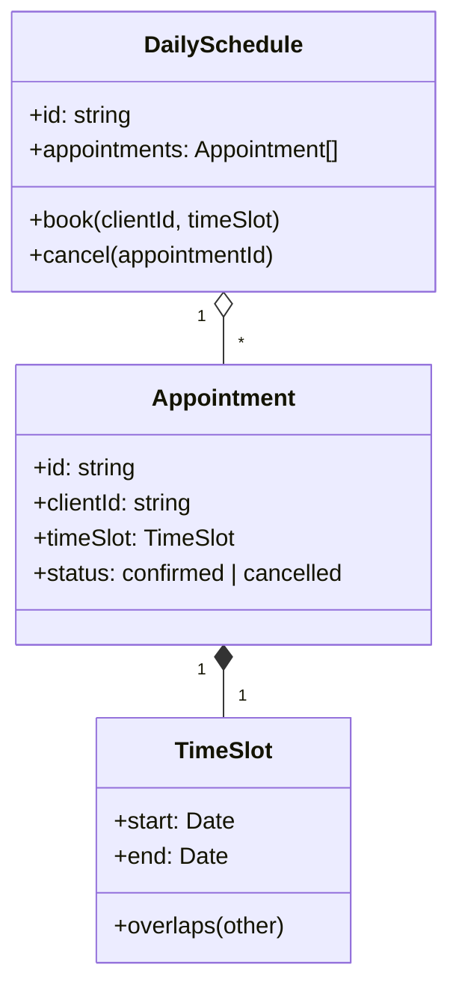

# Booking Domain

**Небольшое DDD-ядро бронирования: слоты, заявки, отмена и защита от двойного бронирования.**

[](#запуск)
[](#api)
[](#тесты)
[](LICENSE)

---

## Что это

Модуль, который я вынес из бота записи на услуги. Задача была простой: не дать двум клиентам занять одно и то же время и не размазать правило «слот занят» по обработчикам Telegram.

Внутри — доменная модель на TypeScript: `DailySchedule` как агрегат, `Appointment` как сущность, `TimeSlot` как value object. Снаружи — use cases и порты, которые можно подключить к Postgres, Redis или in-memory хранилищу.

Это не фреймворк и не SaaS. Это компактный пример того, как выглядит бронирование, если правила живут в домене, а не в контроллерах.

---

## Модель



Ключевое правило: пересечение подтверждённых заявок запрещено. Проверка живёт в агрегате и в инварианте, поэтому её нельзя забыть в новом use case.

---

## API

### Записать клиента

```ts
import { scheduleAppointmentUseCase } from "./src/application/schedule-appointment.use-case";

const result = await scheduleAppointmentUseCase({
  clientId: "uuid",
  startTime: new Date("2026-11-20T10:00:00"),
  durationInMinutes: 60,
});

// { appointmentId, clientId, startTime }
```

Если слот пересекается с существующей заявкой — `Time slot is not available`.

### Свободные слоты

```ts
import { getAvailableTimeSlotsUseCase } from "./src/application/get-available-time-slots.use-case";

const slots = await getAvailableTimeSlotsUseCase({
  startDate: new Date("2026-11-20T00:00:00"),
  endDate: new Date("2026-11-20T23:59:59"),
});
```

Use case отдаёт часовые окна с 9:00 до 17:00, свободные от подтверждённых заявок. Рабочие часы — константа в use case; для реального проекта это параметр ресурса.

### Отменить заявку

```ts
import { cancelAppointmentUseCase } from "./src/application/cancel-appointment.use-case";

await cancelAppointmentUseCase({ appointmentId: "uuid" });
// { appointmentId, status: "cancelled" }
```

---

## Запуск

```bash
bun install
bun test
bun run demo
```

`demo` создаёт расписание на завтра, бронирует 10:00, показывает, что слотов стало на один меньше, отменяет заявку и возвращает слот.

---

## Структура

```text
src/
├── domain/
│   ├── daily-schedule.aggregate.ts   # инварианты и действия
│   ├── appointment.entity.ts
│   ├── time-slot.vo.ts
│   └── date-key.ts
├── application/
│   ├── ports.ts                      # порты хранилища
│   ├── schedule-appointment.use-case.ts
│   ├── cancel-appointment.use-case.ts
│   └── get-available-time-slots.use-case.ts
├── infrastructure/
│   └── in-memory.adapters.ts         # адаптеры для тестов и демо
└── composition.ts                    # связывание портов и адаптеров
```

---

## Тесты

8 тестов: создание клиента, валидация email, успешная запись, отказ при точном и частичном пересечении, полный жизненный цикл «свободно → занято → отменено → снова свободно», отмена несуществующей заявки.

```text
8 pass
0 fail
26 expect() calls
```

---

## Зависимости

- `@maxdev1/sotajs` — небольшая обвязка для сущностей, value objects, агрегатов и DI-портов.
- `zod` — схемы и валидация входа.

Домен не знает про Telegram, HTTP и базу. Это позволяет использовать его и в боте, и в API, и в админке.

---

## Ограничения

- Рабочие часы (9–17) и часовые слоты захардкожены.
- Нет часовых поясов: используется локальное время процесса.
- Нет ресурсов (мастеров, переговорок) — расписание одно на день.
- Нет переноса заявки (reschedule) и повторяющихся слотов.
- Нет блокировок на уровне БД: Race condition между двумя процессами не решён, только внутри агрегата.
- In-memory адаптеры не подходят для production.

---

## Что бы добавил дальше

- `Resource` и политики бронирования (часы / дни).
- Часовые пояса и хранение в UTC.
- Транзакции и уникальные индексы в Postgres.
- Перенос заявки.
- Очередь уведомлений (подтверждение, напоминание, отмена).

---

## Лицензия

MIT.
